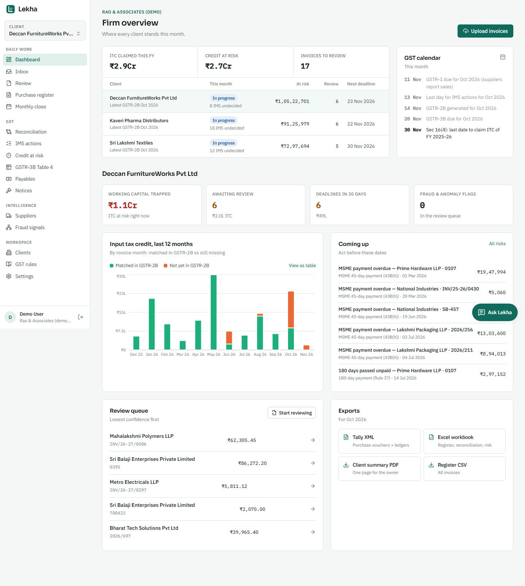
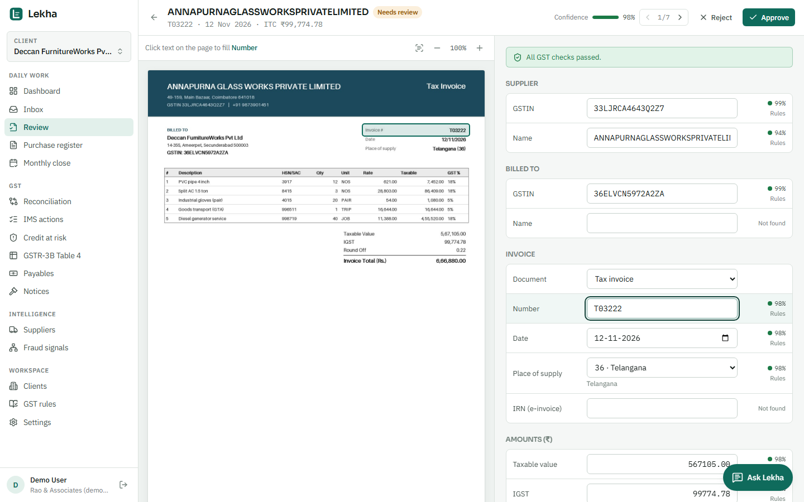
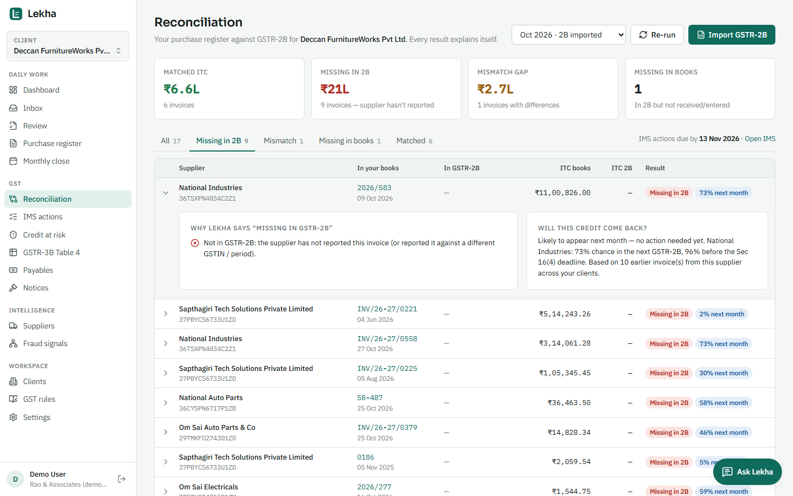
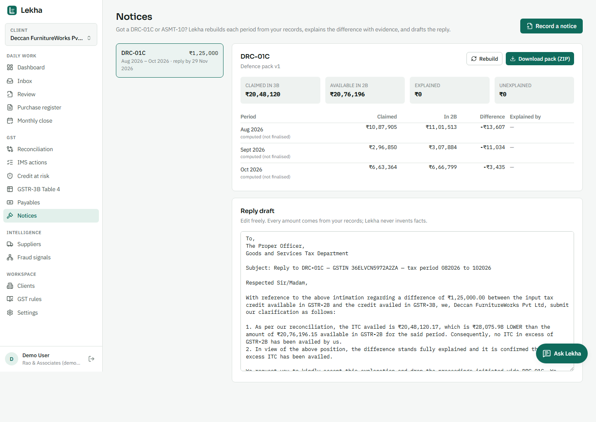
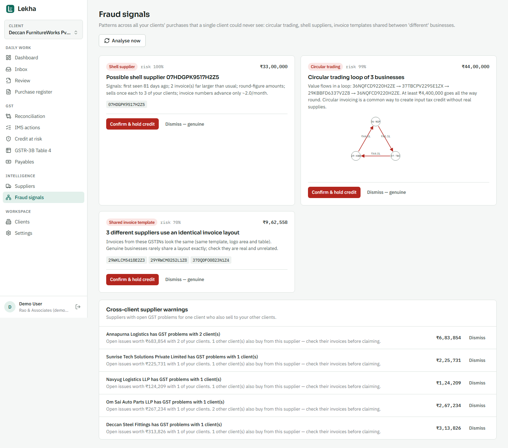

# Lekha

**From invoice photo to protected tax credit.**

Lekha is a web application for Indian businesses and the Chartered Accountant (CA) firms that serve them. It reads GST purchase invoices (PDFs, scans and phone photos), checks them against GST law, compares them with the government's GSTR-2B statement, and shows every rupee of tax credit that is at risk, why, and what to do about it. Every number on screen traces back to the exact spot on the original bill.

[](https://github.com/KrishnaManoharReddy907/lekha/actions/workflows/ci.yml)

| | |
|---|---|
| **Live app** | **https://lekha-silk.vercel.app** — click **Try the live demo** (no sign-up needed) |
| **API health** | https://lekha-api.onrender.com/health |
| **API reference** | https://lekha-api.onrender.com/docs (interactive OpenAPI) |

> The API runs on a free server that sleeps after about 15 minutes without visitors. The first visit after that takes up to a minute while it wakes up; after that it is fast.



---

## Contents

- [The problem](#the-problem)
- [What Lekha does](#what-lekha-does)
- [Key terms](#key-terms-in-plain-language)
- [Try it in two minutes](#try-it-in-two-minutes)
- [Screens](#screens)
- [How it works](#how-it-works)
- [Architecture](#architecture)
- [Technology](#technology)
- [Quality: tests and benchmark](#quality-tests-and-benchmark)
- [Run it locally](#run-it-locally)
- [Deployment](#deployment)
- [Repository layout](#repository-layout)
- [Documentation](#documentation)
- [Limits and disclaimer](#limits-and-disclaimer)

---

## The problem

When an Indian business buys something, it pays GST to its supplier. It can later subtract that tax from the GST it owes on its own sales. This is called **input tax credit (ITC)**, and it is real money: on a ₹1,00,000 purchase at 18% it is ₹18,000.

The credit is only safe if a long list of things is true: the supplier reported the invoice to the government, the invoice details match, the supplier is paid within 180 days, the item is not on the blocked list, the claim is made before the deadline, and more. Every month, accountants have about six days (between the 14th and the 20th) to check hundreds of bills per client against the government's statement, usually by retyping invoices into Tally and comparing spreadsheets by hand. Mistakes cost the business money or bring a tax notice.

Lekha automates that whole cycle, explains every decision, and keeps a person in charge of anything with legal or financial effect.

## What Lekha does

| Area | What you get |
|---|---|
| **Read** | Upload PDFs, scans, phone photos (including iPhone HEIC) or send a no-login upload link to a client. OCR finds every word and its position; AI (free Google Gemini by default, Anthropic Claude optional, an offline reader as fallback) extracts the invoice fields and must point to the words it read them from. The government-signed **e-invoice QR code** is decoded and used to fill gaps and fix misreads, while a genuine disagreement is kept as a tampering signal. Corrections you make are remembered per supplier. |
| **Check** | GSTIN checksum and typo repair; IGST vs CGST+SGST from the place of supply; GST rate valid **on the invoice date** (aware of the September 2025 "GST 2.0" rate changes); arithmetic; invoice-number rules; blocked credit under Section 17(5); duplicate and re-photographed bills; unusual-pattern flags. |
| **Reconcile** | Import GSTR-2B (JSON or Excel from the GST portal). Matching uses supplier PAN, field-by-field similarity scores, split/merged invoice detection and an optimal one-to-one assignment. Every result says in plain language which field differs, by how much, and what to do. |
| **Decide** | IMS (Invoice Management System) accept / reject / pending recommendations with reasons and a portal export; a monthly close workflow that starts when GSTR-2B arrives and stops for human approval; GSTR-3B Table 4 figures with drill-down to the invoices behind each number. |
| **Protect** | A risk ledger in rupees: not in 2B, under-reported, wrong tax head, Rule 37 (pay within 180 days or reverse with interest), Rule 37A (supplier never paid the tax), Section 16(4) (claim deadline), MSME Section 43B(h) (pay small suppliers within 45 days), Section 17(5). |
| **Predict** | A recovery forecaster estimates, per missing invoice, the chance it appears in next month's 2B, before the legal deadline, or never, learned from each supplier's filing history. |
| **Act** | Supplier follow-up messages in English, Hindi and Telugu (copy to WhatsApp or email) and a login-free page where the supplier answers; notice defence packs for DRC-01C / ASMT-10 with a reply draft and a ZIP of evidence; **Ask Lekha**, a read-only assistant for plain-language questions. |
| **Detect fraud** | Across all of a firm's clients: circular trading loops, shell-company patterns, one invoice template used by "different" businesses, and warnings when a supplier causes problems for several clients. |
| **Govern** | Versioned GST rules with effective dates and impact simulation before publishing; Tally XML, Excel, CSV and PDF exports; roles, invites, API keys and an append-only audit log; database-level isolation between firms. |

## Key terms in plain language

| Term | Meaning |
|---|---|
| **GST** | Goods and Services Tax, India's tax on buying and selling since 2017. |
| **GSTIN** | A business's 15-character GST number, e.g. `36ABCDE1234F1Z5` (state code, PAN, entity number, `Z`, check character). |
| **CGST / SGST / IGST** | Central and State GST (half each, for sales within one state) or Integrated GST (for sales between states). |
| **Place of supply** | The state where the supply is consumed; it decides IGST vs CGST+SGST. |
| **ITC** | Input tax credit: GST paid on purchases, subtracted from GST owed on sales. |
| **GSTR-1** | The supplier's return listing its sales invoices. |
| **GSTR-2B** | The buyer's fixed monthly statement of credit, generated by the government on the 14th from suppliers' GSTR-1. |
| **IMS** | Invoice Management System: the buyer accepts, rejects or keeps pending each supplier invoice before GSTR-2B is final. |
| **GSTR-3B** | The monthly summary return where tax is paid and credit is claimed (by the 20th). **Table 4** is its credit section. |
| **Reconciliation** | Comparing the business's own purchase register with GSTR-2B and resolving every difference. |
| **Rule 37 / 37A** | Reverse the credit if the supplier is not paid within 180 days / if the supplier never paid the tax to the government. |
| **Section 16(4)** | The last date to claim credit for a year (30 November of the next year). |
| **Section 17(5)** | Purchases whose credit is blocked, such as food, most vehicles and personal-use items. |
| **Section 43B(h)** | Income-tax rule: pay micro and small (MSME) suppliers within 45 days. |
| **DRC-01C / ASMT-10** | Department notices about differences between credit claimed and credit available. |
| **e-invoice / IRN / QR** | Large suppliers register invoices with the government, which returns a reference number (IRN) and a digitally signed QR code. |
| **CA** | Chartered Accountant. CA firms typically handle GST for dozens or hundreds of client businesses. |
| **Tally** | India's most widely used accounting software. |

## Try it in two minutes

1. Open **https://lekha-silk.vercel.app** and click **Try the live demo**. Lekha builds a private workspace for a fictional CA firm, *Rao & Associates*, with 3 client businesses and 12 months of realistic purchase and GSTR-2B data (about a minute on the free server; the button shows progress).
2. **Dashboard** — this month's credit, credit at risk, the next deadline and the 12-month trend.
3. **Reconciliation** → tab **Missing in 2B** → click any row to see *why* Lekha flagged it and the forecast of whether the credit will come back.
4. **Review** — an invoice image beside its extracted fields. Click a field to highlight where it was read; click text on the bill to fill a field; **A** approves, **J/K** moves between bills.
5. **Credit at risk**, **IMS actions**, **GSTR-3B Table 4**, **Suppliers**, **Fraud signals** — the rest of the month's work.
6. **Notices** → **Record a notice** → **Build defence pack** — a reply draft and evidence ZIP for a DRC-01C notice.
7. **Ask Lekha** (bottom right) — ask "What deadlines are coming up?"

Anyone can do this: the demo needs no account, and each visitor gets their own private copy. To use Lekha for real, click **Create workspace** and choose *CA / accounting firm* or *My business*.

## Screens

| Review workstation | Reconciliation with explanation |
|---|---|
|  |  |
| **Notice defence pack** | **Fraud signals** |
|  |  |

## How it works

```
 Bill (PDF / photo / client link)
   │
   ▼
 OCR: every word + its position on the page ──► signed e-invoice QR decoded
   │
   ▼
 AI extraction (Gemini → Claude → offline reader): each field cites the words it came from
   │
   ▼
 Deterministic GST checks (GSTIN, tax head, rate on the invoice date, arithmetic, 17(5), duplicates)
   │                                   confidence = calibrated mix of all the evidence
   ▼
 Human review (lowest confidence first) ──► purchase register
   │
   ▼
 GSTR-2B import ──► matching + explanations ──► IMS recommendations
   │
   ▼
 Risk ledger (₹) · recovery forecast · supplier follow-ups · Table 4 · exports
```

The AI only reads documents and writes text (summaries, letters, answers). Everything involving money or law is deterministic, tested code, and every consequential step waits for a person's approval.

## Architecture

```
Browser ── Next.js website (Vercel) ── /api/* proxy ──► FastAPI (Render, Docker)
                                                         │  routers → services → engines
                                                         │  background worker (Postgres job queue)
                                                         ├──► PostgreSQL (Supabase): data, jobs, row-level security
                                                         ├──► File storage (Supabase Storage, S3-compatible)
                                                         └──► AI: Google Gemini (free tier) · Claude · offline
```

- **One address for the browser.** The website forwards `/api/*` to the API, so login cookies are first-party and there is no cross-site surface.
- **Firm isolation in the database.** Every tenant row carries a `firm_id`, and PostgreSQL row-level security enforces it on every query, so even an application bug cannot show one firm's data to another. Tests prove it.
- **Postgres as the job queue.** Long work (demo creation, OCR, reconciliation, the monthly close, notice packs) runs as background jobs claimed with `FOR UPDATE SKIP LOCKED`, retried with backoff; pages poll for status. Interactive jobs run before bulk recomputation.
- **Built for a 512 MB free server.** OCR detector input is capped, heavy libraries are never imported unless needed, and memory is returned to the OS after every job; verified by building a demo inside the production Docker image under a hard 512 MB limit.

Details: [docs/ARCHITECTURE.md](docs/ARCHITECTURE.md).

## Technology

| Layer | Tools |
|---|---|
| Website | Next.js 16, React 19, TypeScript, Tailwind CSS 4, TanStack Query, Recharts |
| API and worker | Python 3.12, FastAPI, SQLAlchemy 2 (async), Alembic, Pydantic |
| Database | PostgreSQL 16/17 with row-level security |
| Documents | RapidOCR (ONNX Runtime), PyMuPDF, OpenCV, Pillow, zxing-cpp (QR) |
| AI | Google Gemini REST API (default, free tier), Anthropic Claude SDK (optional), offline rules |
| Algorithms | NumPy, RapidFuzz, NetworkX; own optimal-assignment solver; discrete-time survival model |
| Testing | pytest (106 tests), Playwright (21-screen browser test), synthetic benchmark |
| Delivery | Docker, GitHub Actions CI, Vercel, Render, Supabase |

## Quality: tests and benchmark

| Check | How to run | Covers |
|---|---|---|
| **Backend tests** (106) | `cd apps/api && uv run pytest` | GSTIN, rules time-travel, validation, matching, IMS, risk, Table 4, forecaster, fraud graph, Tally XML, the document pipeline, the full GST cycle through the API, firm isolation under row-level security, demo, close, notices, rules, copilot, exports, memory-saving replacements cross-checked against SciPy |
| **Browser test** | `cd apps/web && npx playwright test` | A visitor's journey across 21 screens with zero console or server errors; run against the live site with `E2E_BASE_URL=https://lekha-silk.vercel.app` |
| **Benchmark** | `cd apps/api && uv run lekha bench --n 60 && uv run lekha bench-eval` | Field accuracy on 60 synthetic invoices with exact ground truth |
| **CI** | every push to `main` | Lint + backend tests, website type-check + build, then deploys the API to Render |

Benchmark highlights ([docs/BENCHMARK.md](docs/BENCHMARK.md)): AI extraction **98.6%** of fields correct, **100%** after signed-QR reconciliation; offline reader (no AI at all) **92.1%**.

## Run it locally

Requirements: Docker, Python 3.12 with [uv](https://docs.astral.sh/uv/), Node 22.

```bash
docker compose -f infra/docker-compose.yml up -d                       # PostgreSQL on port 5433
cd apps/api && uv sync && cp .env.example .env && uv run lekha migrate \
  && uv run uvicorn lekha.main:app --port 8000                         # API + background worker
cd apps/web && npm install && npm run dev                              # website on http://localhost:3000
```

Open http://localhost:3000 and click **Try the live demo**. To read real bills with AI, put a free Google AI Studio key in `apps/api/.env` as `GEMINI_API_KEY`; without it Lekha uses its offline reader.

Useful commands (in `apps/api`): `uv run lekha demo --email you@example.com` (demo workspace with a password), `uv run lekha worker` (separate worker process), `uv run lekha seed-rules`.

## Deployment

| Piece | Service (free plan) | What it holds |
|---|---|---|
| Website | **Vercel** | The Next.js app; forwards `/api/*` to Render. Connected to GitHub, so every push to `main` redeploys it. |
| API + worker | **Render** (Docker) | FastAPI, the background worker and OCR. CI triggers a deploy through a deploy hook after tests pass. |
| Database | **Supabase** (Mumbai) | PostgreSQL with all tables, row-level security policies and the job queue |
| Files | **Supabase Storage** | Uploaded bills and generated packs, private, served only through short-lived signed links |
| AI | **Google AI Studio** | Gemini free tier; Lekha fails over between models and falls back to offline reading |

Step-by-step setup: [docs/DEPLOY.md](docs/DEPLOY.md).

## Repository layout

```
apps/
  api/                 Python: FastAPI app, worker, domain engines, tests, Dockerfile
    lekha/
      engines/         pure GST logic (gstin, rules, validation, matching, ims, risk, table4, forecast, graph, qr, tally)
      services/        use-cases (pipeline, reconcile, close, notices, copilot, demo, ...)
      routers/         HTTP endpoints, one file per area
      ai/  ocr/  jobs/  core/  models/  bench/
    migrations/        Alembic (schema + row-level security)
    tests/             unit and integration tests
  web/                 Next.js website and Playwright browser tests
docs/                  plan, architecture, user guide, benchmark, deployment, images
infra/                 docker-compose for local PostgreSQL
render.yaml            Render service definition
.github/workflows/     CI and API deployment
```

## Documentation

- [docs/PLAN.md](docs/PLAN.md) — product scope (22 parts) and technical plan
- [docs/ARCHITECTURE.md](docs/ARCHITECTURE.md) — how the system is built and why
- [docs/USER_GUIDE.md](docs/USER_GUIDE.md) — using Lekha month to month
- [docs/BENCHMARK.md](docs/BENCHMARK.md) — measured accuracy
- [docs/DEPLOY.md](docs/DEPLOY.md) — deploying on free tiers
- API reference — interactive OpenAPI at [`/docs`](https://lekha-api.onrender.com/docs) on the API server

## Limits and disclaimer

- Lekha does not connect to the GST portal directly (that requires a licensed GST Suvidha Provider); you download GSTR-2B from the portal and import it, as most CA firms already do. Live GSTIN status lookup and WhatsApp Business sending are out of scope for the same reason; each has an adapter point.
- The free hosting is slow to wake and has small AI quotas. For production use: a paid instance or a separate worker, daily database backups and an email provider.
- Lekha recommends; people decide. It is not tax advice. GST rules are versioned with effective dates and must be kept current.
- All demo and benchmark data is synthetic. GSTINs in it are valid in format but fictitious.
