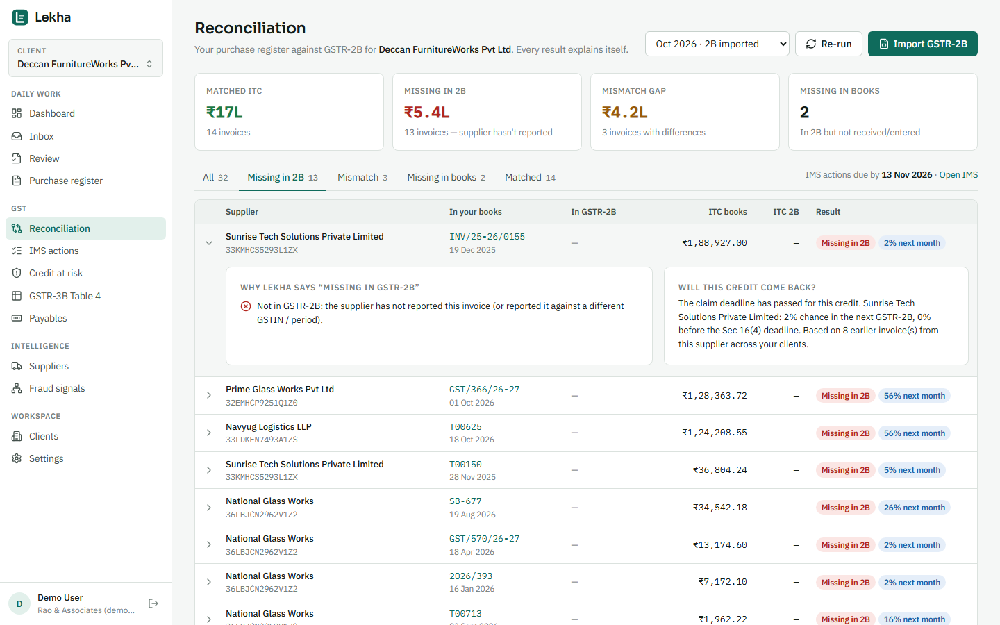

# Lekha

**From invoice photo to protected tax credit.** Lekha reads Indian GST purchase invoices with AI, checks them against GST rules, reconciles them with GSTR-2B, recommends IMS actions, tracks every rupee of input tax credit (ITC) at risk, predicts whether missing credit will come back, chases suppliers, detects fake-invoice patterns, and drafts replies to department notices. Every number traces back to the source document.

Built for CA firms (many clients) and businesses (one GSTIN or several).



## What it does

| Area | Highlights |
|---|---|
| **Read** | PDFs, scans, phone photos and HEIC; OCR with word positions; AI extraction (free Google Gemini by default, Claude optional, offline rules as fallback) where every field cites the OCR tokens it came from; **signed e-invoice QR decoding** that fills gaps and corrects misreads while keeping genuine mismatches as a tampering signal; supplier memory that learns from corrections |
| **Check** | GSTIN checksum and typo repair; IGST vs CGST+SGST by place of supply; GST rates valid **on the invoice date** (GST 2.0 aware); arithmetic; invoice-number rules; Sec 17(5) blocked credit; duplicate and near-duplicate (re-photographed) bills; anomaly flags |
| **Reconcile** | GSTR-2B JSON/Excel import; explainable matching (PAN-aware candidates, feature scores, split/merge, optimal one-to-one assignment); typed mismatches with plain-language reasons |
| **Decide** | IMS accept/reject/pending recommendations with deadlines and a portal export; monthly close workflow started by GSTR-2B with human approval gates; GSTR-3B Table 4 with drill-down sources |
| **Protect** | Risk ledger in rupees: not in 2B, under-reported, wrong tax head, Rule 37 (180 days, with interest), Rule 37A, Sec 16(4), MSME Sec 43B(h), 17(5) |
| **Intelligence** | Recovery forecaster (discrete-time survival model with empirical-Bayes shrinkage); supplier scorecards; cross-client warnings; circular-trading cycles; shell suppliers; one invoice template used by different GSTINs |
| **Act** | Supplier follow-ups in English, Hindi and Telugu with WhatsApp/email hand-off and a login-free supplier self-service page; notice defence packs (DRC-01C/ASMT-10) with reply draft and evidence ZIP; copilot for plain-language questions |
| **Govern** | Versioned GST rules with effective dates and impact simulation before publishing; Tally XML, Excel and PDF exports; roles, invites, API keys, audit log; Postgres row-level security per firm |

## Run it locally (3 commands)

Requirements: Docker, Python 3.12 with [uv](https://docs.astral.sh/uv/), Node 22.

```bash
docker compose -f infra/docker-compose.yml up -d                       # Postgres
cd apps/api && uv sync && cp .env.example .env && uv run lekha migrate \
  && uv run uvicorn lekha.main:app --port 8000                         # API + worker
cd apps/web && npm install && npm run dev                              # http://localhost:3000
```

Open http://localhost:3000 and click **Try the live demo** — a private CA-firm workspace with 3 clients and 12 months of synthetic data is built in about 30 seconds. To read real bills with AI, put a free Google AI Studio key in `apps/api/.env` as `GEMINI_API_KEY`; without it, Lekha uses its offline reader.

## Tests

| Suite | Command | What it covers |
|---|---|---|
| Unit + integration (Python) | `cd apps/api && uv run pytest` | Engines (GSTIN, rules time-travel, validation, matching, IMS, risk, Table 4, forecaster, graph, Tally), the document pipeline, full GST cycle through the API, firm isolation via row-level security, demo, close, notices, rules, copilot, exports |
| Browser end-to-end | `cd apps/web && npx playwright test` | A visitor's journey across 21 screens in Chrome with zero console or server errors |
| Benchmark | `cd apps/api && uv run lekha bench --n 60 && uv run lekha bench-eval` | Extraction accuracy by field and document type — see [docs/BENCHMARK.md](docs/BENCHMARK.md) |

## Documentation

- [docs/PLAN.md](docs/PLAN.md) — product scope and technical plan
- [docs/ARCHITECTURE.md](docs/ARCHITECTURE.md) — how the system is built and why
- [docs/USER_GUIDE.md](docs/USER_GUIDE.md) — using Lekha month to month
- [docs/BENCHMARK.md](docs/BENCHMARK.md) — measured accuracy
- [docs/DEPLOY.md](docs/DEPLOY.md) — deploying on free tiers (Supabase, Render, Vercel)
- API reference — interactive OpenAPI at `/docs` on the API server

## Stack

FastAPI · SQLAlchemy 2 (async) · PostgreSQL 16 with row-level security · Postgres job queue · RapidOCR · PyMuPDF · zxing-cpp · Google Gemini / Anthropic Claude · NumPy, SciPy, NetworkX · Next.js 16 · React 19 · Tailwind 4 · TanStack Query · Recharts · Playwright.

## Disclaimer

Lekha recommends; people decide. It is not tax advice. GST rules are versioned with effective dates and sources and must be kept current. All demo and benchmark data is synthetic; GSTINs in it are syntactically valid but fictitious.
